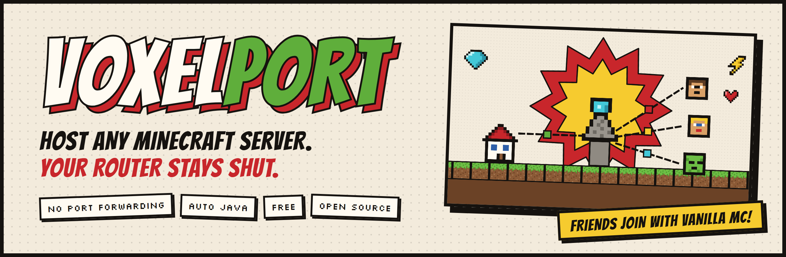
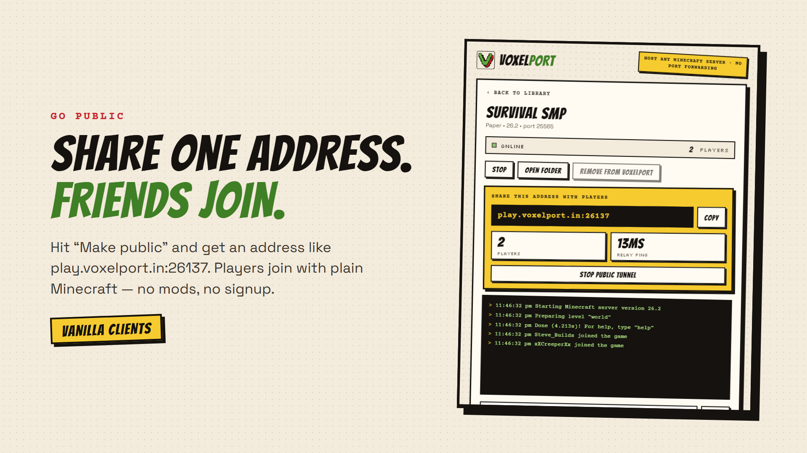
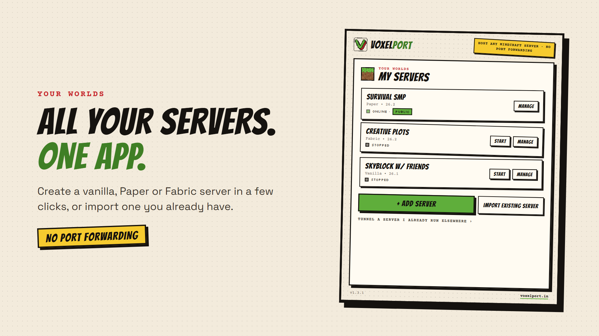
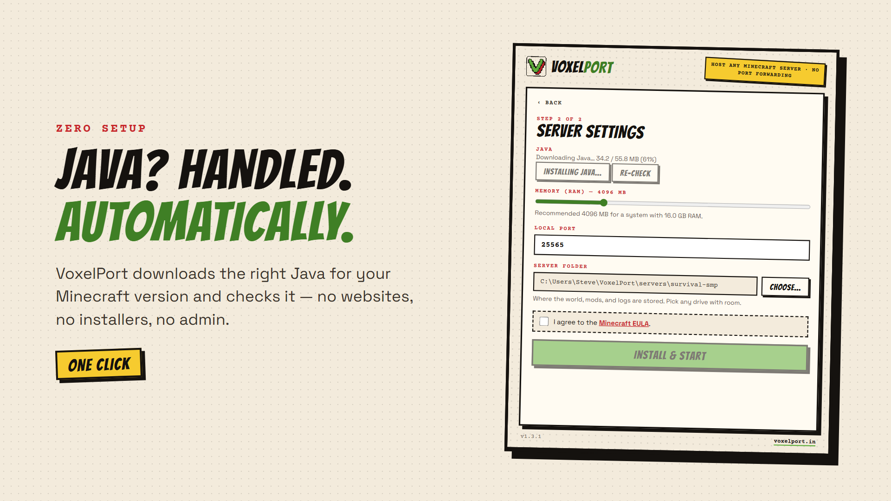
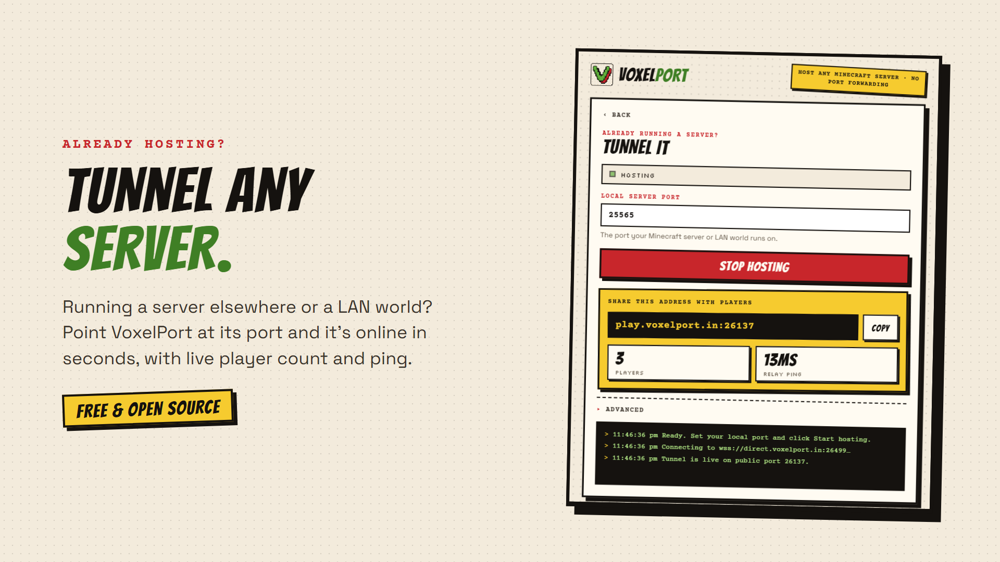

<p align="center">
  
</p>

<p align="center">
  <a href="https://github.com/VOXELPORT/VoxelPort-App/releases/tag/v2.0.0-beta.2"></a>
  <a href="https://github.com/VOXELPORT/VoxelPort-App/releases"></a>
  <a href="https://voxelport.github.io/status"></a>
  <a href="https://discord.gg/2wJbCPwP4r"></a>
  <a href="LICENSE"></a>
</p>

<h3 align="center">
  The new VoxelPort: rebuilt on Tauri and Rust. Host a Minecraft server from your PC, friends join with plain Minecraft.<br />
  No port forwarding · friends need no account · hosts sign in with <a href="https://discord.gg/2wJbCPwP4r">Discord</a> once.
</h3>

<p align="center">
  <a href="https://github.com/VOXELPORT/VoxelPort-App/releases/download/v2.0.0-beta.2/VoxelPort-Setup.exe"></a>
  <a href="https://voxelport.github.io/guides/host-minecraft-server-android-phone"></a>
</p>

<p align="center"><sub>Windows 10 and 11 · <a href="https://voxelport.github.io">voxelport.github.io</a></sub></p>

---

> **This is the source of the new app (branch `tauri`).** The previous Electron app lives on [`main`](https://github.com/VOXELPORT/VoxelPort-App/tree/main). It is not going away: it still works, and its 1.18.0 version has a button that moves you here.

## 🔄 Moving over from the previous app

Update your current app to **1.18.0** and press **Update to the new VoxelPort**. It downloads and checks the new app, installs it, brings over your servers, backups, VoxelPort ID, address and settings, then removes the old app. Your server folders and worlds are never touched, and if anything goes wrong the old app and your data stay as they are. You sign in with Discord once in the new app.

Installing by hand? Open the new app and it offers to bring your data over from the previous one.

**Windows warnings.** The installer is not code-signed yet, so Windows may say "Windows protected your PC": click **More info**, then **Run anyway**. If Windows 11 **Smart App Control** is on, it blocks the installer with no Run anyway button. Switching it off (Settings › Privacy & security › Windows Security › App & browser control › Smart App Control settings) lets you install, but Windows cannot turn it back on later without reinstalling Windows. If you would rather not, keep using the previous app.

## ⚡ Zero to online in four steps

| | |
|:-:|---|
| **1** | **Install** the app from [voxelport.github.io](https://voxelport.github.io/download) or the [release page](https://github.com/VOXELPORT/VoxelPort-App/releases/tag/v2.0.0-beta.2) and sign in with Discord once. Friends never need an account. |
| **2** | **Create** a new server (Vanilla, Paper, Fabric, or the Bedrock Dedicated Server) or **import** one you already have. |
| **3** | Press **Start**, then **Make public**. You get an address like `play.voxelport.in:26137`. |
| **4** | Friends paste it into **Multiplayer → Add Server**. Done. |

## 📸 Screenshots

<table>
  <tr>
    <td width="50%"></td>
    <td width="50%"></td>
  </tr>
  <tr>
    <td align="center"><b>Live console</b> — share the address, watch players join, see your ping.</td>
    <td align="center"><b>Your servers</b> — keep as many as you like, start any with one click.</td>
  </tr>
  <tr>
    <td></td>
    <td></td>
  </tr>
  <tr>
    <td align="center"><b>Java handled for you</b> — the right version, installed in seconds.</td>
    <td align="center"><b>Bring your own</b> — tunnel any server that's already running.</td>
  </tr>
</table>

<sub>Screenshots are from the previous app; the new app shows the same screens.</sub>

## 🆕 What is different in the new app

- 📦 **Far smaller** — the installer is about 3 MB (the previous one is over 100 MB) and the program about 7.6 MB, because it uses the web view Windows already has instead of shipping its own browser.
- 🦀 **Rust backend** — the server, tunnel, backups, Java and update logic are rewritten in Rust (`crates/voxelport-core`, `src-tauri`). All 87 screens' calls are ported; the list is in [docs/FEATURE_PARITY.md](docs/FEATURE_PARITY.md).
- 🪨 **Bedrock Dedicated Server** — the real `bedrock_server.exe` is a server type of its own, tunnelled through the relay.
- 🔄 **One-click move** from the previous app, with an import of your servers, backups, ID, address and settings.
- ✍️ **Signed updates** — updates are verified against a public key built into the app before they are installed.

Honest numbers, measured on one PC: **memory and start-up time are not better than the previous app** (both show the same screen through a Chromium-based web view). Size on disk is the clear win. Details and limits: [docs/PERFORMANCE_COMPARISON.md](docs/PERFORMANCE_COMPARISON.md).

## ✨ What you get

- 🌍 **No port forwarding** — the app dials out to the relay; your router and home IP stay private.
- 🏷️ **Your own address** — claim `yourname.voxelport.in` for free. Friends join without a port number.
- 📱 **Bedrock players too** — one switch installs Geyser + Floodgate so phone, console and Windows players join the same server.
- 🎮 **Vanilla clients** — Java players need nothing but Minecraft.
- ⚙️ **Settings screen** — game mode, difficulty, max players, whitelist, MOTD, view distance and more, without editing files.
- 🔓 **Cracked players** — optional switch (off by default), with a clear warning and one-click login protection.
- 📊 **Performance panel** — live CPU, RAM and TPS, with a warning when the server can't keep up.
- 💾 **World backups** — automatic backups while the server runs and when you stop it, with one-click restore. Restoring saves your current world first, so you can always undo it.
- 🧩 **Plugins & mods** — search Modrinth from the server page and install Paper plugins or Fabric mods in one click. Every download is checked against Modrinth's checksum.
- 🩺 **Crash explanations** — if the server stops, VoxelPort says why in plain words and offers the fix.
- ☕ **Automatic Java** — installs the correct Eclipse Temurin (Java 25 for Minecraft 26.1+).
- 🚀 **Low ping** — your server connects straight to the relay, with an automatic Cloudflare fallback if your network blocks the direct route.
- 🔁 **Address backup** — lock your address with a passphrase and save it to your Discord account. VoxelPort cannot read the backup and cannot recover a forgotten passphrase.
- 🇮🇳 **Hinglish interface**, dark, light or match-system theme.
- 🔒 **Discord sign-in, no password** — VoxelPort never sees your Discord password or email. The sign-in token and device key are encrypted on your PC.
- 💚 **Free & open source** — MIT-licensed, like the [relay](https://github.com/VOXELPORT/relay).

## ❓ FAQ

<details>
<summary><b>Do my friends need VoxelPort?</b></summary>

No. They join with normal Minecraft using the address the app gives you.
</details>

<details>
<summary><b>Does the new app update itself?</b></summary>

Yes. It checks for updates and verifies them against its built-in public key before installing.
</details>

<details>
<summary><b>Do I need a Discord account?</b></summary>

To host with the app, yes: you sign in with Discord and join our server once. VoxelPort only receives your permanent Discord ID, your display name and whether you are in the server, never your email, your password or an access token. Friends who just play need nothing.
</details>

<details>
<summary><b>Where are my worlds stored?</b></summary>

On your PC, in the folder you choose for each server. The relay only forwards traffic and never stores your world or player data.
</details>

## 🛠️ For developers

```bash
npm install
cargo test --workspace      # the Rust tests
cargo build -p voxelport-tauri
```

Prerequisites, the generated parts, the development switches and the release build: **[docs/BUILD_INSTRUCTIONS.md](docs/BUILD_INSTRUCTIONS.md)**. Code layout: **[docs/ARCHITECTURE.md](docs/ARCHITECTURE.md)**. How the move from the previous app was planned: **[docs/MIGRATION_PLAN.md](docs/MIGRATION_PLAN.md)**. Test results: **[docs/TEST_RESULTS.md](docs/TEST_RESULTS.md)**. Security model: [SECURITY.md of the previous app](https://github.com/VOXELPORT/VoxelPort-App/blob/main/SECURITY.md).

---

<p align="center">
  <sub>Not affiliated with Mojang or Microsoft. Minecraft is a trademark of Mojang AB.<br />Made by <a href="https://github.com/trazhub">trazhub</a> · <a href="https://voxelport.github.io">voxelport.github.io</a></sub>
</p>
