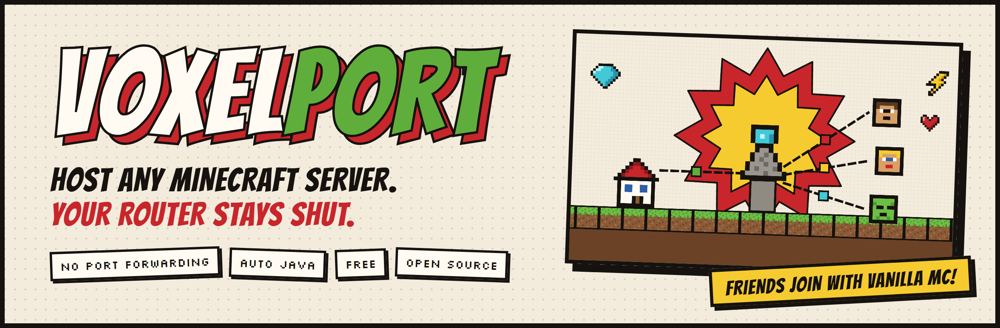
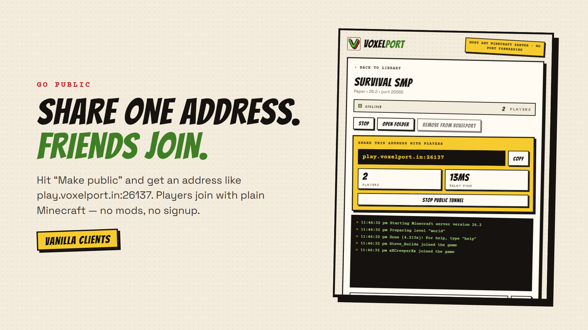
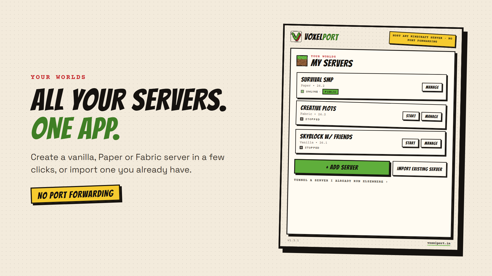
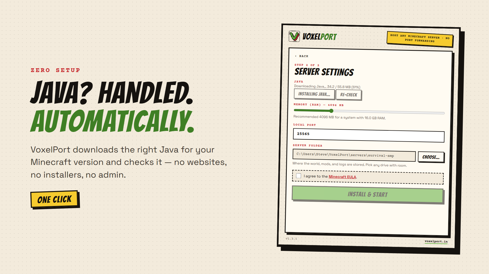
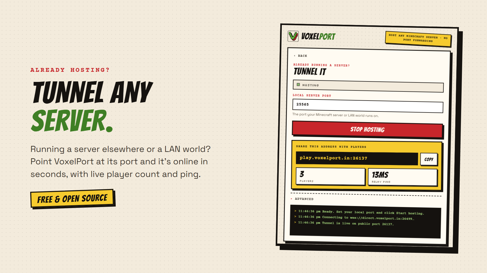

<p align="center">
  
</p>

<p align="center">
  <a href="https://github.com/VOXELPORT/VoxelPort-App/releases/latest"></a>
  <a href="https://github.com/VOXELPORT/VoxelPort-App/releases"></a>
  <a href="https://voxelport.in/status"></a>
  <a href="https://discord.gg/JAUfmey2fP"></a>
  <a href="LICENSE"></a>
</p>

<h3 align="center">
  Host a Minecraft server from your PC. Friends join with plain Minecraft.<br />
  No port forwarding · friends need no account · hosts sign in with <a href="https://discord.gg/JAUfmey2fP">Discord</a> once.
</h3>

<p align="center">
  <a href="https://apps.microsoft.com/detail/9NGRX9CFNBD6"></a>
</p>

<p align="center">
  <a href="https://github.com/VOXELPORT/VoxelPort-App/releases/latest/download/VoxelPort-Linux.tar.gz"></a>
</p>

<p align="center">
  <a href="https://voxelport.in/guides/host-minecraft-server-android-phone"></a>
</p>

<p align="center"><sub>macOS coming soon · <a href="https://voxelport.in">voxelport.in</a></sub></p>

---

## ⚡ Zero to online in four steps

| | |
|:-:|---|
| **1** | **Install** the app from the [Microsoft Store](https://apps.microsoft.com/detail/9NGRX9CFNBD6) and sign in with Discord once. Friends never need an account. |
| **2** | **Create** a new server (Vanilla, Paper or Fabric) or **import** one you already have. |
| **3** | Press **Start**, then **Make public**. You get an address like `play.voxelport.in:26137`. |
| **4** | Friends paste it into **Multiplayer → Add Server**. Done. |

## 📸 Screenshots

<table>
  <tr>
    <td width="50%"></td>
    <td width="50%"></td>
  </tr>
  <tr>
    <td align="center"><b>Live console</b> — share the address, watch players join, see your ping.</td>
    <td align="center"><b>Your servers</b> — keep as many as you like, start any with one click.</td>
  </tr>
  <tr>
    <td></td>
    <td></td>
  </tr>
  <tr>
    <td align="center"><b>Java handled for you</b> — the right version, installed in seconds.</td>
    <td align="center"><b>Bring your own</b> — tunnel any server that's already running.</td>
  </tr>
</table>

## ✨ What you get

- 🌍 **No port forwarding** — the app dials out to the relay; your router and home IP stay private.
- 🏷️ **Your own address** — claim `yourname.voxelport.in` for free. Friends join without a port number.
- 📱 **Bedrock players too** — one switch installs Geyser + Floodgate so phone, console and Windows players join the same server.
- 🎮 **Vanilla clients** — Java players need nothing but Minecraft.
- 🧩 **Templates** — Survival SMP, Java + Bedrock, Creative Flat, Hardcore, Peaceful, Modded — pick one and go.
- ⚙️ **Settings screen** — game mode, difficulty, max players, whitelist, MOTD, view distance and more, without editing files.
- 🔓 **Cracked players** — optional switch (off by default) so friends without a paid Minecraft account can join, with a clear warning and one-click login protection (AuthMe).
- ♥ **Support screen** — one-click tipping (UPI QR, GitHub Sponsors), the optional supporter perks, and suggestions for paid 24/7 hosting.
- 📊 **Performance panel** — live CPU, RAM and TPS, with a warning when the server can't keep up.
- 💾 **World backups** — automatic backups while the server runs (only if someone played) and when you stop it, with one-click restore. Restoring saves your current world first, so you can always undo it.
- ⚡ **Lighter on the connection** — the app and the relay now send game data as raw bytes instead of base64 text, about a third less data and less work on both ends. It switches on by itself when the relay supports it.
- 🧩 **Plugins & mods** — search Modrinth from the server page and install Paper plugins or Fabric mods in one click, with the libraries they need. Every download is checked against Modrinth's checksum, and Remove only deletes what VoxelPort installed.
- 📋 **Copy invite message** — a ready-to-send message with the address, Bedrock instructions and "hosted with VoxelPort", in English or Hinglish.
- 🇮🇳 **Hinglish interface** — switch the whole app to Hinglish (Hindi in the English alphabet) from the footer.
- 📣 **Relay announcements** — if the relay is about to restart, you see it in the app and your players see it in the game's chat.
- 🩺 **Crash explanations** — if the server stops, VoxelPort says why in plain words (port in use, missing mod, out of memory…) and offers the fix.
- 🌐 **Server list** — optionally show your server on [voxelport.in/servers](https://voxelport.in/servers).
- ☕ **Automatic Java** — installs the correct Eclipse Temurin (Java 25 for Minecraft 26.1+) and fixes "needs a newer Java" errors on its own.
- 📦 **Any server** — Vanilla, Paper, Fabric, modpacks, or any server jar you already have.
- 🚀 **Low ping** — your server connects straight to the relay, with an automatic Cloudflare fallback if your network blocks the direct route.
- 🔁 **Address backup** — lock your address with a passphrase and save it to your Discord account. On a new PC or phone, sign in and restore the same address. VoxelPort cannot read the backup and cannot recover a forgotten passphrase.
- 📱 **Android app** — host from your phone too ([install guide](https://voxelport.in/guides/host-minecraft-server-android-phone), [source](https://github.com/VOXELPORT/voxelport-mobile)), with the same Discord sign-in and the same address backup.
- 🔄 **Check for updates** — a button in Settings tells you whether you are up to date.
- 🔒 **Discord sign-in, no password** — hosts sign in with Discord and join our server once. VoxelPort never sees your Discord password or email. A private device key is created on first run and encrypted on your PC.
- 💚 **Free & open source** — MIT-licensed, like the [relay](https://github.com/VOXELPORT/relay).

## ❓ FAQ

<details>
<summary><b>Do my friends need VoxelPort?</b></summary>

No. They join with normal Minecraft: Java Edition using the address the app gives you.
</details>

<details>
<summary><b>Does it update itself?</b></summary>

Yes on Windows. The Microsoft Store keeps its version up to date (Microsoft reviews each update, so it can arrive about a day after a release), and the direct installer updates itself. **Settings → Check for updates** tells you where you stand. On Linux, download the new release when one comes out.
</details>

<details>
<summary><b>Do I need a Discord account?</b></summary>

To host with the app, yes: you sign in with Discord and join our server once. Discord asks for your permission on its own page, and VoxelPort only receives your permanent Discord ID, your display name and whether you are in the server, never your email, your password or an access token. Friends who just play need nothing.
</details>

<details>
<summary><b>How do I keep my address on a new PC or phone?</b></summary>

Open **Address backup** in Settings, choose a passphrase of at least 12 characters and back up. On the new device, sign in with Discord and restore. The backup is locked on your device, so VoxelPort cannot read it or recover a forgotten passphrase. The PC and Android apps share the same backup.
</details>

<details>
<summary><b>Where are my worlds stored?</b></summary>

On your PC, in the folder you choose for each server. The relay only forwards traffic — it never stores your world or player data. Backups go in VoxelPort's own data folder ("Open backups folder" on the Backups screen). They hold your world(s), server.jar and player lists, and they stay on your PC. Mods, plugins and their configuration are not included. Restoring a newer backup also restores its server.jar; older world-only backups leave the installed jar alone.
</details>

## 🛠️ For developers

```bash
npm install
npm start      # run the app
npm test       # the full test suite
```

Architecture, code layout, packaging and releases: **[DEVELOPMENT.md](DEVELOPMENT.md)** · Security model: **[SECURITY.md](SECURITY.md)**

---

<p align="center">
  <sub>Not affiliated with Mojang or Microsoft. Minecraft is a trademark of Mojang AB.<br />Made by <a href="https://github.com/trazhub">trazhub</a> · <a href="https://voxelport.in">voxelport.in</a></sub>
</p>
